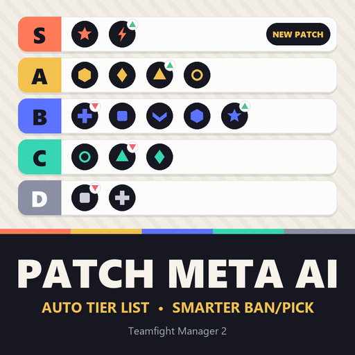

# Patch Meta AI — 选人顾问 + 更聪明的 Ban/Pick + 自动梯队（团战经理 2 / Teamfight Manager 2）

按你存档里的真实胜负数据工作的原生 Mod（稳定版 Mod API，游戏 0.6 及以上）。2.0 起，它用**一个统一的统计模型**同时估计英雄强度、分位置强度、选手实力与熟练度、队友配合和对位克制，然后：

1. **选人界面**：左下角显示你的阵容胜率，右下角给出当前最佳选择和禁用（附理由；禁用阶段给出最该禁的三个，见下文"教练式禁用"），每张英雄卡片显示此刻选它的价值，敌方每个已选英雄标出最可能的位置。选人顺序也算在内：对方后面还有几手、有没有强力克制，都会压低先手暴露的英雄的价值。Fearless 模式下显示本系列已锁定的英雄数。换位阶段，右下角改为显示把五个英雄分给五名选手的最佳方式。
2. **战术界面**：选完人后，模型按你的阵容和本存档里各战术的实际胜负，在值得改的战术选项上标出 ★ 和收益。
3. **首发界面**：按选手实力、位置评分和英雄池（熟练度）推荐五名首发，名单行上标 ★ 和位置；名单下方有空间时列出他们最好的英雄。
4. **版本分析页**（经典界面在左侧菜单，新界面在顶部标题栏右侧）：英雄 / 组合 / 选手 / 补丁变化 / 模型 五个标签。英雄表可按位置筛选、按任意列排序，显示对线期经济差；选手页给出训练建议（值得练的英雄）；补丁变化页列出本版本上升、下降和被改动的英雄。
5. **F8 面板**（任何界面）：梯队榜、下一个对手的侦察（每名选手的拿手英雄、常用英雄、最该禁的英雄）、你的选手英雄池、模型准确度、上一次 BP 的复盘。
6. **AI 的 ban/pick**：按本局局面给候选英雄估值（位置、配合、克制、伤害类型），推动 AI 原有评分。游戏 0.6.4 起还看双方的上场选手：AI 偏向自家选手的拿手英雄，并禁掉对方选手的拿手英雄。
7. **自动梯队**：维护你队伍的 S/A/B/C/D 英雄梯队。
8. **报告**：Mod 文件夹里的 `meta_report.html`（浏览器打开，可排序、搜索）和 `meta_table.txt`。

数据全部来自你的存档：大会比赛、单排、球队新闻里的补丁公告。游戏会删掉很旧的比赛记录，所以 Mod 把每个存档的比赛另存在 Mod 文件夹的 `history/` 里（不改存档），下次读档时补回来；只有存档里最近的比赛确实出现在这个文件里时才会合并，同一支队伍的不同存档不会混在一起。

## 教练式禁用（3+2 等任何禁用规则）

禁用阶段（第一轮 3 个、第二轮 2 个，或其他任何规则），右下角的三行换成**最该禁的三个英雄**（禁 1 / 禁 2 / 禁 3），英雄卡片上显示禁掉它值多少（禁 x.x）。对方禁用时，三行显示**对方最想禁我们的**（敌禁?）。

禁用价值不是"这个英雄多强"，而是"禁掉它，对方阵容会变差多少"：

- 对方每个还空着的位置，把场上剩下的英雄都按"对方来选"估值（这个位置的强度、和对方已选英雄的配合、对我方已选英雄的克制、补不补得上对方阵容的缺口、对方这个位置的选手熟不熟），禁用价值 = 对方在这些位置上的最佳选择因此下降多少。有同样好的替代品时几乎不值得禁；**没有替代**的、能打多个位置的**摇摆位**英雄值得禁。
- 第一轮（双方都没选人）自然偏向版本强势、独一档的英雄；第二轮（各选三个之后）只看对方还缺的位置，自然偏向克制我方已选英雄、补对方阵容缺口的英雄。
- 禁掉的英雄我们也拿不到：减去我方因此损失的选择，下一手是我方先选时减得更多（先手能直接拿走它，没必要禁）。我方选手的拿手英雄因此不容易被建议禁掉。
- 理由列写出原因，例如"中路 无替代 · 克我方 +1.2 · 补前排"。

选人时，选它还能顺便让对方拿不到：推荐的选人也加上一半"禁掉它的价值"（抢）。AI 的禁用用同样的算法。

**英雄联盟经验**（`lol_prior`，默认 1）：存档里的比赛少时，模型从英雄联盟的经验出发，比赛多了由数据修正：
- 全部 165 个英雄联盟英雄的官方位置（和 Smart Position Lock 同一份列表），用来判断英雄打哪路；
- 每个英雄的阵容属性（`presets/league_comp.ini`：伤害类型，前排、开团、保护、消耗、突进、后期输出、控制各 0～2），模型据此学习"阵容缺前排 / 缺开团 / 伤害类型单一 / 控制少 / 输出少 / C 位没人保护"各损失多少胜率，选人和禁用都会算上补阵容缺口的价值；
- 职业赛场梯队（S～D）作为英雄强度的起点，知名的配合与克制作为配合/克制的起点。

## 选人界面的其他教练功能（2.4）

- **推演**：3+2 规则下轮到你禁用或选人时，把当前最好的 5 个候选各自推演到 BP 结束（之后双方每一手都按本 Mod 的估值选最好的，从最强的约 30 个英雄里选），按推演出的最终阵容胜率重新排序，理由列开头显示"推演 xx%"。其他禁用规则下不推演。
- **阵容类型和缺口**：左下角胜率下面写出双方阵容的类型（开团 / 消耗 / 突进 / 保C / 坦克）和最大的缺口（缺前排、伤害单一……）。
- **对手侦察**：对方队伍最近 20 场的常用英雄让它更可能选这些英雄。右下角第四行"敌可能"列出对方下一手最可能选的三个，禁用理由里标"对方常用"。
- **估值明细**：游戏的英雄信息栏显示某个英雄时（悬停或点它的卡片），选人格子底部出现一行明细：选它的价值由哪些部分组成（位置强度、配合、克制、阵容、选手、抢、被克、留后局），禁它的价值（对方损失、我方损失、无替代、对方常用）。
- **Fearless 系列赛**：Bo3 / Bo5 的 Fearless 规则下还有后续对局时，用掉一个没有替代的英雄会扣一点价值（"留后局"），后面的局越多扣得越多。
- **BP 复盘**：离开选人界面后，F8 面板最后一页列出这次 BP 的每一手：哪一方、选还是禁、当时对我方的价值、当时的建议和它的价值、之后的胜率，以及照建议走了几手（`diag.log` 里也有一行 `[review]`）。
- **困难 AI**（`ai_draft=on`，默认关）：所有 AI 队伍的禁和选都**完全按本 Mod 的建议**来——和你在面板上看到的同一套排序（禁用看禁掉后对方损失多少，选人看位置强度、配合、克制、阵容、被克风险、"抢"），双方上场选手的熟练度，3+2 规则下把最好的 5 个候选推演到 BP 结束再定（AI 的蓝红方从 BP 进行到哪一步推出来）。选人只在 AI 还空着的位置能打的英雄里选。和教练托管一样排在所有 Mod 最后决定，盖过地狱人机等。一手在 1～2 毫秒内算完，AI 之间的比赛也照此 BP。`diag.log` 的 `[ai]` 行写 AI 每一手选了什么（你自己的比赛全写，其他比赛写前几手），`[review]` 行写 "ai_draft N decided, M of them made"：M 小于 N 说明被别的 Mod 盖掉了。
- **教练托管**（`coach=on`，默认开）：选人时交给游戏的教练托管，你自己的队伍**完全照面板的建议**禁和选（2.5 起直接决定，不再只是给游戏评分加分）：轮到你时面板为这一手画出的排序（禁 1 / 选，推演、Fearless、位置锁都算在内）；面板还没为这一手画好时，按模型估值选最好的、能放进空位置且没被位置锁挡住的。它排在所有 Mod 的最后决定，所以别的 Mod 整手接管时也以它为准。`diag.log` 的 `[coach]` 行写每一手决定了什么，`[review]` 行写"coach override N decided, M of them made"：M 小于 N 说明被别的 Mod 盖掉了。即使 `ban_pick=off` 也生效，不影响其他队伍。
- **英雄联盟经验自动校准**（`lol_prior=auto`，默认）：存档比赛够多后（约 150 场大会比赛），用最新的比赛检验 0 / 0.5 / 1 / 2 哪个权重预测最准并自动采用，比赛增加两成后重新检验；F8 模型页显示当前权重和六种阵容缺口各值多少胜率。

## 2.5：属性先验、胜率校准、地狱人机

- **属性先验**（`stats=auto`）：每个英雄的强度从它的属性出发——攻击、法强、生命、护甲、魔抗、移速和它们的成长，在同类英雄（近战 / 远程 / 法师 / 辅助 / 刺客）里标准化——每项属性值多少由模型从全部比赛里学（所有英雄共用十二个权重和每类一个偏移）。比赛少、甚至没上过场的英雄，按属性相近的英雄的表现估计。`auto` 用最新的比赛检验开 / 关哪个更准（和 `lol_prior` 一起检验）；F8 模型页显示最值钱的几项属性。
- **胜率校准**：同一次检验还找出模型的对数几率乘多少最贴近没参与拟合的比赛（0.2～1.2）。小于 1 说明模型偏自信，显示的胜率（左下角、推演、复盘）都按它收缩；排序不受影响。F8 模型页和 `diag.log` 的 `[model] held-out check` 行写着这个系数。
- **地狱人机（Hell Draft AI，`hell_draft_ai`）**：它整手决定 AI 队伍的 BP，几乎没有随机性，主要按存档胜率（它自己的统计）和属性给英雄评级。检测到它启用且接管 AI 队伍时，本 Mod 按它的方式预测对方：每个英雄加上它的偏好（本版本 AI 队伍的选用 + 禁用率，和它 `cache/history.json` 里的胜率，各最多约 ±0.5 对数几率），"敌可能"和推演里对方的选人按这个偏好；对方的禁用（敌禁? 和推演）按"最强位置的强度 + 偏好"排序，而不是按禁掉后我方损失多少。它的 `ally_draft_ai` 开着时 `diag.log` 会提醒：本 Mod 的教练托管排在最后，复盘显示被盖掉时在它的配置器（F7）里关掉"我方 AI"。本 Mod 只读它的文件，不改。另外它算作"接管 AI 选人的 Mod"：`ban_pick=auto` 时让给它。
- `diag.log` 里的模型检验行（`[model] model check ...`）以前可能因为排队的拟合被跳过而不出现，现在总会写。

## 2.7：地狱 AI 第二版

- **AI 研究对手**：困难 AI 和面板一样看双方最近 20 场常用的英雄，对方常用的更值得禁，自己常用的更可能选。
- **让所有英雄都有机会上场**（`ai_variety`，默认 1）：以前困难 AI 是确定的——同样的局面永远选同一个英雄；在一个真实存档上模拟 60 局 AI 对 AI 的 BP，一共只用到 5 个英雄。现在每局 BP 开始时，每支 AI 队伍按模型对每个英雄的把握"抽"一次它这局的判断（模型越拿不准的英雄浮动越大：没怎么上过场的英雄有时会被看好，公认强势的几乎不动），同一局里保持不变。AI 按这个判断挑，但每一手最多比模型认为的最佳选择差 `ai_variety` 个胜率点（3+2 时把想选的也推演到 BP 结束，按推演胜率比），差得更多就仍选最佳。同一个存档上：上限 1 时用到 30 个英雄、代价约 2 个胜率点；上限 2 时 37 个、约 5 个点。副作用是好的：每个英雄都有比赛数据，模型也更准。0 = 关。
- **AI 的战术**（`ai_tactics`，默认关）：AI 队伍以前的战术基本随机（一个存档里 1188 场 AI 用了 681 种组合），有的选项明显吃亏（原始胜率：收尾"稳健"42% 对"灵活"52%，前期峡谷先锋"放弃"45% 对"灵活"53%）。打开后，由模型 BP 的队伍——`ai_draft` 开着时的 AI 队伍，以及你用教练托管自动 BP 的那一局（`coach=on`）——在比赛开始时按模型给这五个英雄选最好的战术（战术界面上 ★ 的那些）。比赛会先在服务器上预演出结果、再在客户端重演给你看，每次开场必须一样：所以战术只在服务器第一次预演时决定，按十个英雄存进 Mod 文件夹的 `ai_tactics.json`，之后的重演和回放都照用；这个功能之前的比赛不改。比赛记录如果还写着开场前的战术，读记录时会换成实际用的，模型不会学错。要带数据的选项（大龙兵线的 Split131 / Split14 分哪两路）只在队伍本来就是那一种时保留，不自己编。`diag.log` 的 `[tactics]` 行写设了什么（你的比赛全写）。
- **近期加权**（`recency`，默认 auto）：英雄 Mod 改英雄时游戏版本号不变，模型以前把改动前后的比赛一样看待。现在可以让新比赛权重更高——早 N 场大会比赛的只算一半；`auto` 用最新的比赛检验 关 / 400 / 1200 哪个最准。一个存档最新 150～300 场上：不加权 log-loss 0.71～0.72（比五五开的 0.693 还差，模型过度自信），400 场减半时 0.694～0.696。这也说明双方都按模型 BP 之后，BP 本身已经很难决定胜负。

## 2.5.3：游戏 0.7.0

游戏 0.7.0 的稳定版 Mod API 没变（自带的 SDK 和本 Mod 用的完全一样），改的是界面：

- **管理界面三种样式**：经典界面照旧（左侧菜单"房子"下面）。新界面（浅色 / 深色）的左侧菜单排满到底，入口改放在顶部标题栏，在游戏自己的按钮（推进、日期、撤销 / 重做……）左边，跟着它们移动；打开的页面从标题栏下面开始，标题栏照常能用。游戏的新界面主题表按颜色值把经典配色换成浅色 / 深色主题的颜色，本页用的就是这些经典配色。主机布局（手柄，"自动"模式用手柄时切过去）的菜单是一排标签、屏幕底部是手柄按键提示，那里没有入口，已打开的页面会关掉；F8 面板照常能开。
- **首发界面**：0.7.0 在选手行的位置列前面加了"综合评分（OVR）"列，★ 标签改为按游戏的实际坐标放在位置列右端，不再压住名字和 OVR；主机布局的行更高、名单更短，标签和下方面板也按实际坐标放（主机布局下名单下方放不下面板）。
- **战术界面**：主机布局把按钮放在了提示文字原来的位置，提示改到战术组下面；★ 标签在选项里上下居中。
- 选人界面的叠加层三种样式都不用改。

## 和其他 Mod 一起用

- **Bows' Drafter's Toolbox**：可以同时开。`tier_list=auto`（默认）检测到它时把梯队交给它；Toolbox 不改 AI 选人，所以本 Mod 的 AI 部分照常工作。两者在选人界面的标注位置不同（本 Mod 在卡片名字那一行和屏幕下方两角）；如果嫌挤，可以设 `grid_values=off`。
- **Bows' Terminator Draft AI**：它完全接管 AI 选人，`ban_pick=auto` 检测到它时自动让出。选人顾问、面板和报告照常工作。
- **Smart Position Lock（智能位置锁定）**：位置锁定是单独的 Mod。教练托管和困难 AI（`ai_draft`）是直接决定选谁的，会越过它的评分锁，所以 2.6.1 起本 Mod 直接读它的位置表（它 `settings.ini` 的 `[positions]`，没有的用它内置的列表——本 Mod 带着同一份 `presets/league_positions.ini`，锁位置文件夹里那份 `league_positions.ini` 可能是旧的，不读——再没有的用它从选人卡片学到的 `positions.json`），按它的规则（选进来后全队还能一人一个位置排开）只选合法的英雄；它的 `ai` / `player` 开关关着时不限制对应的一方。模型估计英雄在哪些位置打时也以这张表为准。它的设置改了几秒内重新读。和它一起用时，被它锁住的英雄不会出现在推荐里，卡片上也不显示价值。tfm2mods 的 Champion Position Lock 同样可以一起用。游戏 0.6.4 起 AI 选完人后还有一步"分配位置"，本 Mod 不参与：位置由游戏或 Smart Position Lock 决定（几个 Mod 同时决定时只有最后一个生效，所以本 Mod 不去抢）。
- **地狱人机（JIN 的 Hell Draft AI）**：可以同时开。AI 队伍的 BP 交给它（`ban_pick=auto` 让出），本 Mod 按它的方式预测对方（见上文 2.5）；教练托管仍以本 Mod 为准。
- **yudra 的 Win-Rate Ban/Pick AI**（已停止更新）：会被检测到并让出梯队和 AI 选人，但建议直接停用它。

启用了哪些 Mod 是从游戏的 `config/game/mods.json` 读的。另外，如果梯队在游戏内换日后连续被别的东西改回去，本 Mod 也会自动停止写入并在 `diag.log` 里说明。

## 安装

- **手动安装**：把 `patch_meta_ai` 文件夹（含 `patch_meta_ai.dll`、`mod.mod_info`、`thumbnail.png`，以及给玩家的使用说明 `README.txt`）放进 `<游戏目录>\mods\`，进游戏在 Mod 菜单里启用（含代码的 Mod 会弹一次确认），重启游戏。
- 只有 Windows 版（`.dll`）。

## 原理

所有比赛（最近 `patches` 个版本的大会比赛，加上按 `solo_weight` 计的单排）拟合一个带先验的逻辑回归：

`P(蓝方胜) = sigmoid(蓝方优势 + Σ蓝方[英雄强度 + 位置修正 + 选手实力 + 选手×英雄熟练度] − Σ红方[…] + Σ队友配合 − … + Σ对位克制)`

- **英雄强度按版本**：每个英雄在每个版本有一个强度，相邻版本之间是"随机游走"——没被改动时最多漂移约 `drift`，被补丁加强/削弱时最多变化约 `change`，并朝改动方向预移 `patch_shift`。所以改动前的比赛仍然计入，只是分量变小；新版本的少量比赛能把估计推多远，由模型自己按证据决定。
- **选手实力**：强队的拿手英雄不会因为"强队在用"而被高估。
- **所有效应都有先验**（往 0 收缩），场次少的配合、克制、熟练度会自然地接近 0。
- 拟合在后台线程进行（L-BFGS，大存档几十毫秒），不占游戏帧。

显示的"实力胜率"= 队友和选手都是平均水平时、这个英雄所在队伍的胜率。"争夺率"= 选用率 + 禁用率；"协同""压制"= 两个英雄同队或对位时，比各自实力预期多赢的胜率百分点。梯队按保守估计（强度减一个标准差）排序后按比例切分。

**选人顾问**对每个可选英雄计算：它在剩余位置里最常打的那个位置的强度 + 与已选队友的配合 + 对已选敌人的克制 + 将由哪名选手使用时的熟练度 − 伤害类型单一的惩罚。禁用价值 = 这个英雄对敌方的价值（含敌方对应选手的熟练度），按出场+禁用率加权。敌方位置推断用每个英雄的历史位置分布对所有分配方式加权，所以和游戏语言无关。

**AI 的 ban/pick** 用同样的估值，经 tanh(价值 / edge_scale) × 强度后加到游戏原有的评分上。从 0.6.4 起，游戏会把双方的上场选手（按位置顺序）交给 AI：选人时再加上本队将打该位置的选手对这个英雄的熟练度，禁用时加上对方该位置选手的（位置不明时取全队平均），乘以 `player_mastery`（默认 0.5），每名选手最多计 ±0.5（对数几率）——默认下这一项最多约 ±6 个胜率百分点，只是推一把。这里的熟练度是模型从本存档比赛里估出的"选手×英雄"效应（扣除英雄本身和选手本身的实力，场次少时接近 0），不是游戏自己的熟练度数值：游戏的原有评分已经算过那个，再加一次就重复了。模型还没拟合出来时（刚读档）AI 照游戏原样选；游戏没给阵容（0.6.4 之前）、选手模型不认识、或 `player_mastery=0` 时，与不看选手时完全一样。

**模型自检**：读完存档后，用除最新 10% 外的比赛拟合，再在最新的比赛上打分（热门方获胜率、Brier 分数），结果写进 `diag.log`、报告和 F8 面板。

## 设置：`settings.ini`

第一次运行时自动生成，改完保存几秒内生效（模型相关的下次重建时生效），不用重启。删掉会重新生成默认值。1.x 的旧设置文件可以直接用，旧的模型参数会被忽略。

| 段落 | 键 | 默认 | 作用 |
|---|---|---|---|
| `[features]` | `ban_pick` / `tier_list` | auto / auto | AI 选人、自动梯队：`auto` = 开，除非已启用做同样事情的 Mod；`on` / `off` |
| | `ai_draft` | off | 困难 AI：所有 AI 队伍完全按本 Mod 的建议禁和选（含 3+2 推演、对手习惯），盖过其他 BP Mod |
| | `ai_variety` | 1 | 困难 AI 的多样性：每局对英雄的判断浮动，每一手最多让出这么多胜率点（0～5，0 = 永远选最佳） |
| | `ai_tactics` | off | 由模型 BP 的队伍（AI 队伍；你自动 BP 的那一局）开场时按模型选战术 |
| | `coach` | on | 教练托管时你自己的队伍完全照面板的建议禁和选（即使 `ban_pick=off`，别的 Mod 接管时也以它为准） |
| `[model]` | `patches` | 12 | 模型回看的版本数（含当前，1～12） |
| | `drift` / `change` | 0.08 / 0.3 | 英雄强度每个版本的变化幅度：未改动 / 被补丁改动（对数几率） |
| | `patch_shift` | 0.02 | 补丁加强/削弱时起点预移的胜率 |
| | `solo_weight` | 0.5 | 一场单排算几场大会比赛 |
| | `lol_prior` | auto | 英雄联盟经验（梯队、配合/克制、阵容缺口的损失）作为起点的分量：`auto` = 按存档比赛自动选 0 / 0.5 / 1 / 2，或填 0～3（0 = 不用） |
| | `stats` | auto | 英雄强度从属性出发：`auto` = 按存档比赛检验开 / 关哪个更准；`on` / `off` |
| | `recency` | auto | 新比赛权重更高：早这么多场的只算一半；`auto` = 检验 关 / 400 / 1200；`off`；或填 50 以上的数 |
| | `reworked` | （空） | 本版本重做的英雄 id，历史数据几乎不计 |
| | `roles` `players` `mastery` `pairs` | 0.3 / 0.35 / 0.2 / 0.15 | 位置、选手、熟练度、配合/克制效应的先验幅度（越大越容易被数据推离 0） |
| `[draft]` | `pick_strength` / `ban_strength` | 1.0 / 0.8 | 对 AI 原有评分的影响力度 |
| | `edge_scale` | 0.5 | 价值（对数几率）换算成影响力的尺度：`tanh(价值 / edge_scale)` |
| | `player_mastery` | 0.5 | 游戏 0.6.4 起：双方上场选手对候选英雄的熟练度在 AI 选人/禁用里的分量，0～2（0 = 不看选手） |
| `[tiers]` | `min_games` | 10 | 近期场次（本版本 + 往前每个版本减半）少于此值的英雄不分级 |
| | `s` `a` `b` `c` | 10/20/40/20 | 各梯队所占百分比，其余为 D |
| | `unranked` | keep | 证据不足的英雄：`keep` 保持原梯队，`clear` 设为无梯队 |
| `[screen]` | `draft_overlay` | on | 选人界面的胜率和建议，以及战术界面、首发界面的推荐 |
| | `grid_values` | on | 英雄卡片上的价值 |
| | `lane_tags` | on | 敌方已选英雄的位置推断 |
| | `panel_opacity` | 60 | 两个面板背景的不透明度（0～100）。面板在屏幕底栏的两角（选人位下方、队名左右两侧），原版和 Ban/Pick View Plus（原画 Mod）的布局里都不挡选人位；面板上方那一列选满五个后背景再降到三分之一 |
| | `meta_page` | on | "版本分析"页（经典界面左侧菜单 / 新界面标题栏） |
| `[report]` | `report` | on | 写 `meta_report.html` |
| `[debug]` | `explore` | off | 把每个新界面的 UI 结构写进 `ui_dump_*.txt`（按 F9 随时写一份） |
| | `verbose` | off | 在 `diag.log` 里写更多细节 |

## 快捷键

- **F8**：打开 Meta 面板 / 下一页 / 最后一页后关闭。
- **F9**：把当前界面的 UI 结构写进 `ui_dump_*.txt`（反馈界面问题时用）。

## 出问题时看这些文件

都在 Mod 文件夹里：

- `diag.log`：Mod 读到了什么、做了什么（每个存档第一次读到的数据格式写在 `[probe]` 行，选人界面读到了什么写在 `[ui]` 行，AI 选人时看到的双方阵容，以及本次启动游戏后最初几次 AI 决定里排在前面的英雄和其中选手所占的分量，写在 `[draft]` 行）。每次启动游戏重写，上一次的保留为 `diag.prev.log`。反馈问题时请附上它。
- `meta_table.txt` / `meta_report.html`：模型当前的全部数字。
- `history/`：各存档的比赛备份（删掉只会丢失游戏已删除的旧比赛）。
- `probe_competition.json`、`probe_records.txt`：存档数据格式样本（游戏更新后数据格式变了时用来适配）。

## 从源码构建

- Windows：装好 Rust 后在仓库根目录 `cargo build --release`，得到 `target\release\patch_meta_ai.dll`。
- Linux/WSL：`tools/build.sh`，需要 `rustup target add x86_64-pc-windows-gnu` 和 `gcc-mingw-w64-x86-64`。它会跑测试、交叉编译、打包出 `dist/patch_meta_ai/` 和 zip。加 `--smoke` 还会用 Wine 真正加载 DLL，跑一遍模拟的游戏流程。
- `cargo test`：单元测试（模型能否从模拟比赛中找回已知的英雄强度、选手实力、配合；补丁改动后的估计；选人界面读写），加上走真实 C 接口的整局模拟（`tests/fake_host.rs`）。`cargo test --release -- --ignored --nocapture fit_time` 测一次存档规模的拟合耗时。

`vendor/mod-api-stable` 是游戏自带的稳定版 Mod SDK（`mod-sdk-stable`，游戏 0.6.5 自带，ABI 等级 10，和 0.6.4 的只差冻结的 abi_level_10.txt；游戏 0.7.0 自带的和它完全一样），版权归 TeamSamoyed。Mod 只要求 ABI 等级 1，所以用新 SDK 构建的 DLL 在 0.6.0～0.6.3 上照样能加载。

## 致谢

"按胜率调整 ban/pick + 自动梯队"的思路最早来自 yudra 的创意工坊 Mod「Win-Rate Ban/Pick AI + Champion Tiers」，失效原因见 [docs/background.md](docs/background.md)。选人界面标注、高级统计、对手位置标签等功能方向受 Bowsori 的「Drafter's Toolbox」「Terminator Draft AI」启发；UI 路径和界面重建的经验参考了 shirograhm 的开源 Mod「Riot Games Item Expansion Pack」（MIT）。本 Mod 是独立实现，代码、模型、设置和美术都是自己的。

## English

Patch Meta AI is a native Teamfight Manager 2 mod (stable mod API, game 0.6+). Version 2 fits one regularised logistic regression over your save's matches - champion strength per patch (a random walk across patches, wider where the patch notes changed a champion), lane offsets, each player's own strength and champion mastery, ally synergy and opponent matchups - on a background thread, and uses it for:

1. **the ban/pick screen**: your line-up's win chance, the best picks now, and in every ban phase (3+2 included) the three best bans with reasons - or, while the enemy bans, the ones they want against you; picks aware of the draft order (a champion picked early can still be countered); each champion card's value to you, each enemy pick's likely lane, the Fearless count, and the best seating in the swap phase;
2. **the tactics screen**: a star on each tactic option worth changing for your line-up, with its gain;
3. **the line-up screen**: the five suggested starters (strength, position rating, champion pool);
4. **a Meta Analysis page** in the left menu (in game 0.7.0's new UI: in the title bar at the top, left of the game's own buttons; none in the gamepad layout): champions (lane filter, lane-phase gold), pairs, players with training suggestions, patch changes, the model;
5. **an F8 panel** on any screen: tier list, scouting of your next opponent, your players' pools, the model's held-out accuracy;
6. **the AI's bans and picks**, valued in the actual draft (a ban by how much worse the enemy's best options in its open lanes get without the champion - an equally good substitute makes it worth little, a flex pick more - less what it takes from our own options; a pick also by what it does to the team's composition) (position locks are left to Smart Position Lock, a separate mod; the advice skips the cards it locks); from game 0.6.4, which hands both line-ups to the AI, also by the fielded players: a pick counts the mastery of the team's player in the lane it would play, a ban that of the enemy's player, times `player_mastery` (0.5, at most ±0.5 log-odds per player before it) - the AI leans to its players' best champions and bans the enemy players' best. The mastery is the model's own player-on-champion effect from this save's matches, not the game's proficiency number, which the game's own score already counts; unknown players, no line-up (older games) or `player_mastery=0` leave the value as before;
7. **your team's tier list**;
8. **`meta_report.html`** and `meta_table.txt` in the mod folder.

The game prunes old match records; each save's matches are also kept in `history/` in the mod folder (never in the save) and merged back once the save's recent matches confirm the file is its own.

- `ban_pick` / `tier_list` default to `auto`: they step aside for Drafter's Toolbox (tiers) and Terminator Draft AI (AI draft), read from the game's `mods.json`.
- Game 0.6.4 adds a lane-assignment step after an AI team's picks; this mod stays out of it (when several mods decide, the last one wins), so the game or Smart Position Lock assigns the lanes.
- Settings in `settings.ini` are hot-reloaded; `diag.log` shows what the mod sees; F9 dumps the UI tree for bug reports.
- Build with `cargo build --release` on Windows, or `tools/build.sh` from Linux.
- MIT licensed. `vendor/mod-api-stable` is TeamSamoyed's SDK as shipped with game 0.6.5 (ABI level 10, 0.6.4's plus the frozen abi_level_10.txt; game 0.7.0 ships it unchanged); the DLL asks for level 1 only, so it still loads on 0.6.0-0.6.3.
